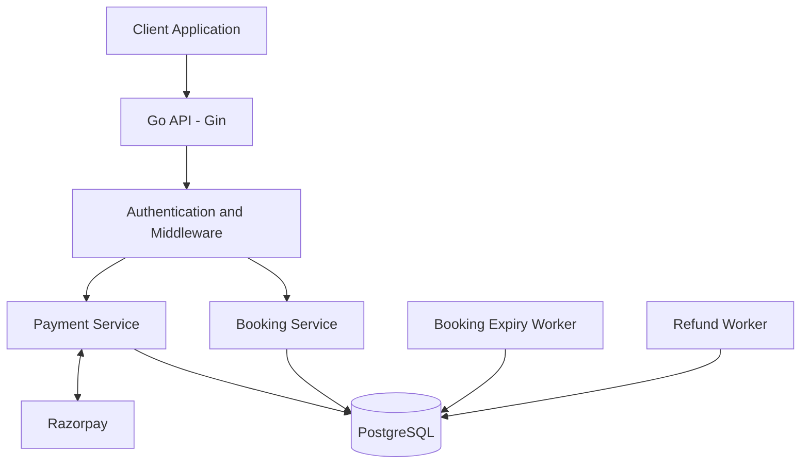

# StayNest — Hotel Booking API

A production-oriented hotel booking backend built with Go, Gin, and PostgreSQL. StayNest provides customer authentication, hotel and room discovery, multi-room bookings, inventory management, payment processing, and background workers.

The project focuses on backend engineering challenges such as database transactions, concurrent inventory management, payment idempotency, webhook verification, and reliable background processing.

## Technology Stack

| Area             | Technology             |
| ---------------- | ---------------------- |
| Language         | Go                     |
| HTTP framework   | Gin                    |
| Database         | PostgreSQL 17          |
| Database driver  | pgx/v5                 |
| Authentication   | JWT                    |
| Containerization | Docker, Docker Compose |
| Payments         | Razorpay               |
| Testing          | Go testing package     |
| CI/CD            | GitHub Actions         |

## Features

### Authentication and Customers

- Customer registration and login
- JWT-based authentication
- Protected customer endpoints
- Customer profile management
- Password change
- Account deactivation

### Hotels and Rooms

- Hotel creation and management
- Room type management
- Public hotel and room discovery
- Hotel search
- Room inventory management

### Booking Management

- Multi-room bookings
- Booking creation, retrieval, modification, and cancellation
- Date-based room inventory management
- Transactional inventory updates
- Protection against concurrent overbooking
- Booking expiration through a background worker

### Payment Processing

- Razorpay payment initiation
- Payment verification
- Webhook signature verification using the raw request body
- Idempotent payment and webhook processing
- Handling different payment and webhook arrival orders
- Refund processing through a background worker

### Reliability and Security

- Strict JSON request validation
- Request body size limits
- Rejection of unknown JSON fields and trailing JSON values
- Login IP rate limiting
- JWT-protected routes
- Health and readiness endpoints
- Graceful server shutdown
- Background worker lifecycle management

## Engineering Highlights

### 1. Concurrent Inventory Management

Booking requests can arrive simultaneously for the same room and date.

StayNest uses PostgreSQL transactions and row-level locking to protect inventory updates and prevent multiple customers from booking the same available inventory.

### 2. Transactional Booking Operations

Operations that affect bookings and inventory are performed transactionally.

This helps maintain consistency when booking creation, modification, or cancellation involves multiple database changes.

### 3. Payment Idempotency

Payment operations and webhook processing must tolerate duplicate requests.

StayNest implements idempotency protections so that repeated payment-related events do not unintentionally apply the same operation more than once.

### 4. Webhook Verification

Razorpay webhook signatures are verified against the raw request body before processing the event.

This helps ensure that incoming webhook requests are authentic.

### 5. Background Workers

StayNest uses background workers for time-sensitive operations, including:

- Expiring eligible bookings
- Processing refunds
- Retrying and reconciling refund operations

The refund worker uses leases and retry handling to support reliable processing.

### 6. Graceful Shutdown

The application handles graceful shutdown by stopping background workers before closing the database connection pool.

This reduces the risk of workers attempting database operations after the database pool has been closed.

## Architecture Overview

